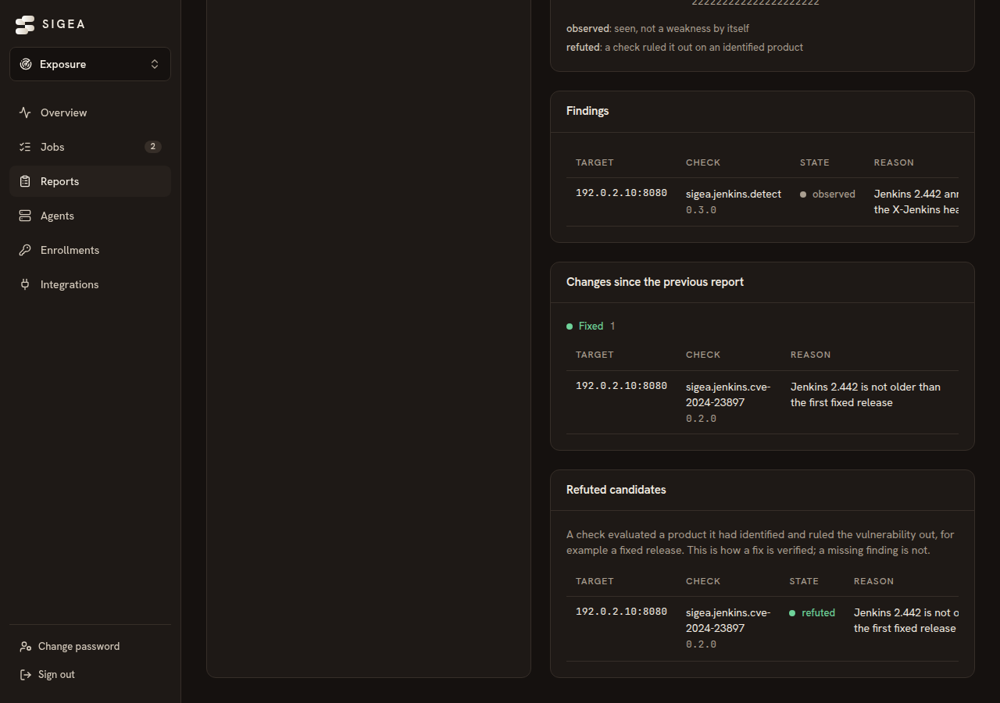
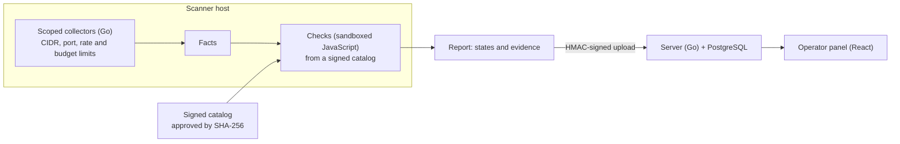

# SIGEA

**A self-hosted security suite built around one rule: a scanner should say how strong its evidence is.**

> **The source code of SIGEA is private.** This repository is the public overview: the design, the
> measurements and the limits. Read access to the code can be given on request (see
> [Access](#access-and-contact)).

Most scanners report "vulnerable" when a version string matches a database entry. SIGEA separates what it
*saw* from what it *concludes*, and it never reports a fix because a finding merely disappeared.

## Status

| Product | What it does | State (November 2026) |
|---|---|---|
| **Exposure** | Finds what is exposed on a network, what changed since the last scan, and what to fix | Install candidate. The whole flow (install, enroll, scan, upload, review) was rehearsed end to end from the package, twice, on the maintainer's machine. **No external installation yet.** |
| **Detection** | Event pipeline with rule-based detections that enrich findings with Exposure data | Laboratory candidate |
| **Edge** | On-premises web gateway with data-loss-prevention policy | Engineering alpha (phase 1), not production-ready |

This is a one-person project. Everything below describes Exposure, the only part exercised end to end.

## The idea: evidence has a strength

Every finding carries a state, derived from what the check that produced it declares about itself:

| State | Meaning |
|---|---|
| `observed` | A product, version or setting was seen. Not a weakness by itself. |
| `probable` | A version or banner matches a vulnerable range. Nothing probed the service. |
| `confirmed` | A probe of the service's behavior indicated the weakness. |
| `refuted` | A check evaluated a product it had identified and ruled the vulnerability out (for example a fixed release). |
| `inconclusive` | The check could not observe what it needs. **Never** read as "not affected". |

Two consequences shape the product:

1. **A version match is a hypothesis, not a finding.** A distribution can backport a fix and keep the
   version number; the check's own report says so.
2. **A fix is verified by a refutation, not by a missing finding.** If a finding disappears, the product may
   simply not have been reached. The interface shows such a case as *Not confirmed fixed*.

*The panel (demo with fictional data): the latest scan refutes the candidate that the previous one reported.*

## One measurement

On a test host running Jenkins 2.441 (vulnerable to CVE-2024-23897) and again after upgrading to 2.442:

| | Nmap 7.98 (`-sV`, `vuln and safe` scripts) | SIGEA check |
|---|---|---|
| Product seen | "Jetty 10.0.18" (the server underneath) | Jenkins 2.441 and Jetty 10.0.18 |
| CVE-2024-23897 | Not mentioned | `probable`: 2.441 is older than 2.442 (weekly) or 2.426.3 (LTS) |
| CVE list | 27 entries, all about Jetty, matched by banner | One finding about the product that matters |
| After upgrading to 2.442 | Output does not change | The finding becomes `refuted` |

This is **one product and one CVE**, not a general comparison. Method and caveats: [docs/evidence.md](docs/evidence.md).

## How it fits together

Details: [docs/architecture.md](docs/architecture.md). Trust boundaries and what is *not* defended:
[docs/threat-model.md](docs/threat-model.md).

## Design choices I would defend

- **Observation and evaluation are separate.** Go collectors observe the network inside a scope the operator
  authorized (addresses, ports, rate, connection budget; no DNS). Checks only evaluate the facts they are
  given, so a check can be replayed offline against a captured observation.
- **Checks are data, not binaries.** A signed catalog carries them; the scanner binary contains none. An
  operator approves each catalog by its hash, and nothing updates itself.
- **Checks run isolated.** Evaluation happens in a separate process under Linux namespaces (Bubblewrap).
  The embedded JavaScript engine is documented as *not* a sandbox by itself.
- **Fail loudly.** When the connection budget runs out, the report is marked incomplete and the command
  exits with an error. Before this rule existed, a real scan returned `inconclusive` for every HTTP check
  without saying why; the case is in [docs/evidence.md](docs/evidence.md).
- **Agents prove who they are on every request.** HMAC-SHA256 over method, path, body hash, timestamp and a
  per-request nonce; replays are rejected from a durable store; keys are encrypted at rest with a key the
  database never holds.
- **A scanner never exploits anything.** A scan is an observation at a moment in time, not a confirmation
  of exploitability.

## What it does not do yet

- No external operator has installed it. The install guide has only been followed on the maintainer's own
  machine (with an AI assistant running the commands).
- The open catalog has 18 original checks: 17 product detectors and one CVE rule (Jenkins). A host that runs
  none of those products produces no findings, which is **not** a statement that it is secure.
- No `confirmed` check is in the open catalog yet; today's CVE findings are `probable`.
- No vulnerability-database (NVD/CPE) matching, no host discovery, and no authenticated (SSH) checks in the open
  catalog.
- Catalogs are installed by file and hash; the server does not distribute them.
- Detection and Edge are not usable by an operator today.

## Engineering practice

Go (server, agent, scanner, check engine), TypeScript/React (panel), PostgreSQL, Python (packaging and
laboratory tooling). Go tests include race-detector runs; the server and agent are tested against disposable
PostgreSQL instances with the real binaries; UI changes are checked in a real browser at desktop and phone
widths. Architecture decisions are written as numbered records before the code that depends on them.
The project is developed with AI coding assistants under the author's direction and review.

## Related projects

- [Ozal](https://github.com/ozal-project/ozal): self-hosted access gateway with SSO and passkeys.
- [Custodia](https://github.com/custodia-project/Custodia): inventory and metrics across security tools.

## Access and contact

- Code: private. Read access on request, for evaluation.
- Contact: octavio.santacruz3@gmail.com
- Author: Octavio Santacruz
