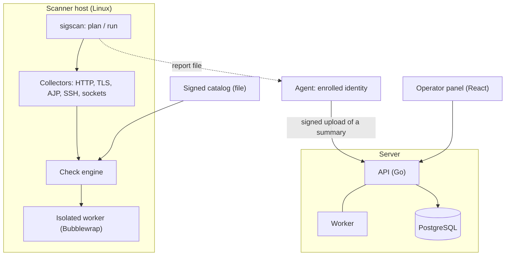
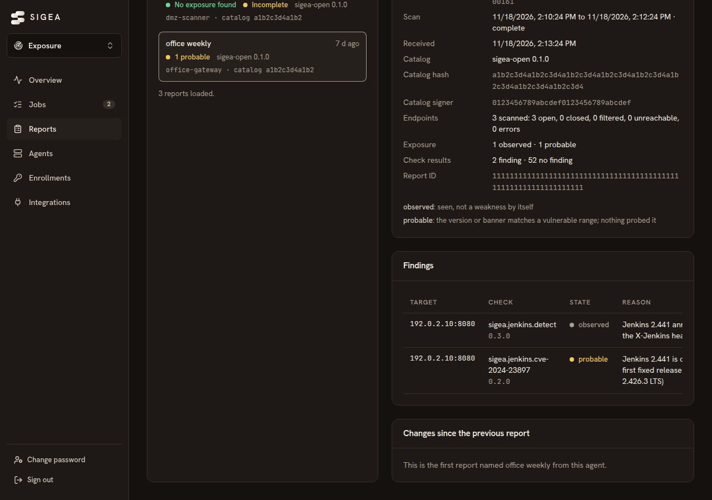

# Architecture (Exposure)

SIGEA Exposure has five parts. The scanner can run without the server; the server only stores and shows
what a scanner reports.

## The scanner

`sigscan` is one Linux binary with two commands: `plan` validates a configuration and lists the endpoints
without sending a packet; `run` scans and writes a report that is never overwritten.

1. **Scope first.** The operator writes the authorization: networks, ports, a rate limit and a connection
   budget. Every connection any collector opens goes through that scope. There is no DNS resolution and the
   socket's peer is checked again before the connection, so nothing can redirect a destination.
2. **Discovery inside the scope.** A TCP connect probe classifies each endpoint (`open`, `closed`,
   `filtered`, `unreachable`) and retries a timeout, because a connect scanner without retries loses a
   measurable share of open ports on a lossy network. A named port profile can replace a long port list.
3. **Collect, then evaluate.** Collectors observe (HTTP responses, certificates, banners) and produce *facts*.
   Checks never touch the network; they evaluate facts. A first stage runs detectors; a second stage runs
   rules that consume what the detectors found (for example, the product and version a detector identified).
4. **Isolated evaluation.** Script checks run in a separate process under Linux namespaces with resource
   limits. Declarative rules are evaluated in Go as data and need no script runtime.
5. **A report with states.** Each finding has a state (see the README), the evidence that supports it, and
   the identity of the catalog that produced it. A scan that exhausts its connection budget is marked
   incomplete.

## Checks and the catalog

A check is a YAML manifest plus either a script or a rule. The manifest declares what the check *claims*:
what it is about (identification, configuration or vulnerability), how it reaches the conclusion (banner,
version, behavior or authenticated), references, preconditions in words, and where it comes from. The
exposure state of a finding is derived from that claim, so a check cannot present a version match as
stronger than it declared.

Checks ship in a **catalog**: one file, signed with Ed25519. The scanner binary contains no checks. The
operator approves a catalog by its SHA-256; an altered file or a different signer is rejected. A rights
policy keeps the open catalog to original work and separates anything derived from third-party sources.

## The agent and the server

An agent enrolls once with a one-use token and then proves itself on every request (see the
[threat model](threat-model.md)). For server-driven scans the agent executes only what its *local* policy
allows (addresses, ports, profiles, runtime, output size); the server can ask but cannot widen the policy.
A standalone scanner's result reaches the server as a bounded summary: counts, the catalog identity and the
findings with their evidence references. Full per-endpoint captures stay on the scanner host.

If the server cannot be reached, the agent keeps the report in a private local queue (files named by the
SHA-256 of their exact bytes, written atomically, bounded in count and size, never evicted silently) and
resends the same bytes on request, which the server recognizes as a duplicate if the first attempt actually
arrived. A rejection caused by the agent's identity or clock (401/403) leaves the whole queue intact; only a
report the server considers invalid (400) is moved to a quarantine directory.

The server is a Go API and a worker over PostgreSQL. Jobs use leases and fencing, results are durable, and
uploaded reports are stored once per exact body (the report's identifier is the SHA-256 of the signed body, so
a repeated upload is recognized instead of duplicated). Operator access is local (password with login
limits) or delegated to an identity provider. The API is described by an OpenAPI document.

## The panel

React and TypeScript. It shows reports, their findings by state, a comparison with the previous report of the
same agent and scan name, jobs and agents. The comparison calls a candidate *Fixed* only when the newer report
refutes it; a candidate that merely disappears is shown as *Not confirmed fixed*.

## Deployment

One package holds the binaries, the panel and an install runbook. It runs either as systemd *user* services
(no root) or as an isolated Docker Compose project used as a laboratory. Installation never changes the host
implicitly; migrating, creating the first administrator and enabling services are explicit steps. A public
one-line installer verifies a signed release manifest, but no public release exists yet.
